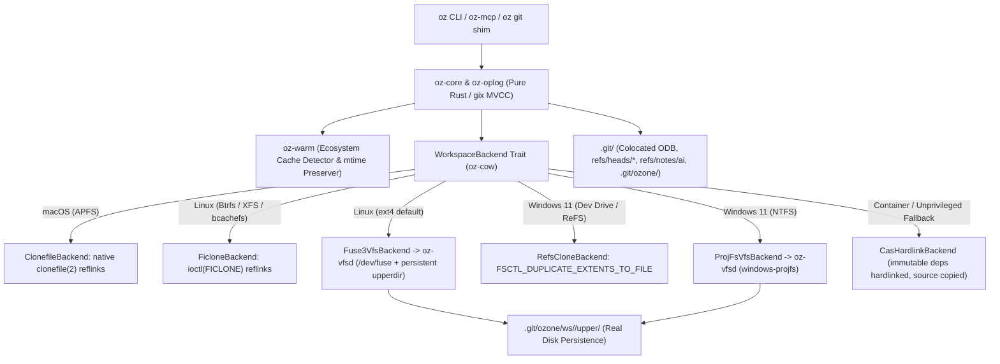

# Ozone (`oz` / `git-ozone`) — Master Architecture Specification

> **Status:** Architecture & Design Specification (Pre-Implementation)
> **Target Platforms:** macOS (`APFS`), Linux (`ext4`, `Btrfs`, `XFS`, `bcachefs`), Windows 11 (`NTFS`, `Dev Drive / ReFS`)
> **License (Local Engine):** Dual-licensed `MIT OR Apache-2.0` (Open-Core with trait seams for Ozone Cloud)

---

## 1. Overview & Design Philosophy

**Ozone (`oz`)** is a GitHub-compatible, pure-Rust Git client and workspace engine architected specifically for the **multi-agent coding era**. It preserves 100% compatibility with existing `.git` tooling and GitHub remotes while eliminating the four failure modes of canonical C `git` under concurrent AI agent load:

1. **Worktree Disk & Warmup Bloat:** Running 5–20 parallel coding agents with `git worktree add` duplicates tracked files, `.git/index` files, and multi-gigabyte ignored caches (`target/`, `node_modules/`, `.venv/`), routinely burning 50–300 GB of SSD space and minutes of cold compile/install latency per workspace.
2. **Global Lock Contention:** Concurrent `git` invocations from multiple agents, background IDE tasks, and subshells race on `.git/index.lock`, `.git/packed-refs.lock`, and `.git/config.lock`, causing `File exists` failures or abandoned stale locks when an agent process is killed.
3. **Fragile Modal States & Interactive Traps:** Half-completed `REBASE_MERGE` / `MERGE_HEAD` states, detached HEADs, and interactive `$EDITOR` / `less` / `git add -p` prompts frequently derail autonomous agents into destructive recovery (`git reset --hard`) or infinite retries.
4. **High Token & Command Overhead:** Standard Git's staging ceremony (`add`, `stash`, `reset`, `checkout`) forces agents to spend ~3–5x more tool calls and context tokens per commit than modern addressable hunk/file interfaces.

### The "`uv` Playbook" CLI Surface

Ozone follows the proven **`uv`** adoption pattern: deliver an unmistakable, streamlined primary interface (`oz`) alongside zero-friction drop-in compatibility (`git-ozone` and `oz git`) backed by colocated `.git` storage.

| Invocation | Role & Behavior |
| :--- | :--- |
| `oz <cmd>` | Primary, streamlined ~10-verb CLI (`clone`, `status`, `diff`, `commit`, `ws`, `sync`, `stack`, `integrate`, `pr`, `ci`, `radar`, `undo`, `blame`, `checkpoint`, `doctor`, `setup`, `agent`, `mcp`). |
| `git ozone <cmd>` | Provided via a `git-ozone` hardlink/symlink binary alias so Git natively discovers `oz` as a Git subcommand. |
| `oz git <cmd>` | Opt-in compatibility shim (users may optionally `alias git="oz git"`). Intercepts the high-impact ~20% of Git commands (`worktree`, `status`, `diff`, `checkout`, `switch`, `commit`, `add`, `merge`, `rebase`, `clone`, `fetch`, `push`) directly on Ozone's CoW + MVCC engine. Obscure legacy plumbing is delegated to system `git`, **wrapped automatically inside pre- and post-execution Ozone OpLog snapshots** so even destructive legacy commands like `git reset --hard` remain 100% reversible via `oz undo`. |

---

## 2. Core Repository, Branch & Staging Model

### 2.1 100% Colocated `.git/` Storage

Ozone operates directly inside standard `.git/` repositories without requiring repo conversion:

* **Standard Git Ownership:** Object database (`.git/objects/`), packfiles, `.git/config`, and canonical branch refs (`refs/heads/*`, `refs/remotes/*`, `refs/tags/*`) stay in standard Git locations. IDEs (VS Code, Cursor, JetBrains), `gh`, `cargo`, and GitHub Actions continue to inspect the workspace seamlessly.
* **Isolated Ozone Namespace:** All Ozone-specific state lives inside `.git/ozone/` and hidden Git refs under `refs/ozone/*` plus AI provenance notes under `refs/notes/ai`:

```text
<repo>/
├── .git/
│   ├── objects/              # Shared Git ODB (blobs, trees, commits, packfiles)
│   ├── refs/
│   │   ├── heads/*           # Real named branches checked out per workspace
│   │   ├── notes/ai          # Optional line/commit AI provenance notes
│   │   └── ozone/            # Internal shadow checkpoints & baseline markers
│   ├── worktrees/<ws>/       # Standard Git linked worktree metadata (colocated)
│   └── ozone/
│       ├── config.toml       # Repo-local Ozone policies & baseline settings
│       ├── oplog/            # Append-only MVCC operation log & ref snapshots
│       ├── state/<ws>.json   # Indexless tree-delta state + pinned file set
│       ├── baselines/        # Quiescent baseline tree + warm build caches
│       ├── ws/<ws>/upper/    # Persistent VFS writable upperdir (ext4 / NTFS)
│       └── vfsd.sock         # Local IPC socket for oz-vfsd (when active)
└── .ozone.toml               # Optional repo-committed config (warm paths, guardrails)
```

### 2.2 Real Branch per Workspace + Auto `Change-Id` Trailers

* **Real Named Branches (`HEAD -> refs/heads/<branch>`):** Every spawned workspace checks out a real local Git branch rather than a detached HEAD. Both human IDE plugins and frontier LLM weights expect a concrete branch name and fail unpredictably on detached HEADs or Jujutsu-style anonymous revisions.
* **Automatic `Change-Id` Commit Trailers:** Every commit authored by `oz commit` automatically appends a deterministic `Change-Id: I<hex>` footer trailer in the commit message (standard Gerrit/GitButler convention) — **never** custom raw commit headers, which GitHub rejects or strips. When commits are amended, split, or rebased across stacked PRs, `Change-Id` preserves logical identity across commits and GitHub PRs.

### 2.3 Stage-Free Working-Tree-First Commits + Addressable File/Hunk IDs

Ozone removes mandatory `git add` staging by default and treats the **working directory as the commit target**:

1. **Default Atomic Commit (`oz commit -m "..."`):**
   * Commits all modified and new non-ignored files in the active workspace directly into a tree built in memory via `gix`.
   * **Pre-Commit Guardrails (Built-In):** Automatically aborts (with structured JSON diagnostics and `--force` override) if changes include:
     * Suspected secrets / unignored `.env` files or private keys
     * Unresolved conflict markers (`<<<<<<<`, `=======`, `>>>>>>>`)
     * Oversized binary blobs (`> 50 MB` by default)
     * Violations of workspace `--scope` or `--deny` path guardrails

2. **One-Shot Surgical Partial Commits (`--pick` / `--exclude`):**
   `oz status` and `oz diff` assign deterministic, short, session-local IDs to every changed file (`f1`, `f2`) and every diff hunk (`h1a`, `h1b`):

   ```text
   ws: agent-auth (branch: feat/pkce, base: main@a1b2c3d)
     M  [f1] crates/auth/src/token.rs   (+24 -3)   hunks: h1a (L12-30), h1b (L94-102)
     A  [f2] crates/auth/src/pkce.rs    (+61 -0)
     M  [f3] crates/auth/src/debug.rs   (+4 -0)    hunks: h3a (L5-9)
   ```

   An agent or developer creates a clean partial commit in **one non-interactive command**:

   ```bash
   oz commit -m "feat(auth): add PKCE verifier" --pick f2 h1a
   ```

   Ozone applies only `f2` and hunk `h1a` onto the parent tree in RAM using `gix` tree builders, advances `refs/heads/feat/pkce`, and leaves `h1b` and `f3` untouched in the working directory — completely eliminating `git add -p`, `git stash`, and `.git/index.lock`.

3. **Optional Virtual `pinned` Set (Compatibility Escape Hatch):**
   If a script or human runs `oz git add <path>` via the compatibility shim, Ozone records `<path>` in `.git/ozone/state/<ws>.json` (`pinned_paths`) without locking or rewriting a multi-megabyte `.git/index`. The next `oz git commit` honors `pinned_paths` and clears them on success.

---

## 3. Workspace Disk Layout & Tiered Cross-Platform CoW Engine

### 3.1 Grouped Sibling Disk Layout

By default, workspaces spawn inside a grouped sibling directory adjacent to the repository root (customizable via config template):

```text
~/dev/
├── my-monorepo/          # Main repository + .git/
└── my-monorepo.oz/       # Grouped Ozone workspace container
    ├── agent-auth/       # CoW workspace (real filesystem path)
    ├── agent-billing/    # CoW workspace (real filesystem path)
    └── _integrate/       # Ephemeral CoW sandbox for conflict resolution
```

**Why `../<repo>.oz/<ws>` is strictly better than alternatives:**
* **Same Mount / Volume / Dev Drive Guarantee:** Placing `<repo>.oz` beside `<repo>` keeps workspaces on the same filesystem partition, preventing cross-device `EXDEV` failures that break native reflinks (`FICLONE`, `clonefile`, `FSCTL_DUPLICATE_EXTENTS_TO_FILE`) when using global `~/.oz/` directories.
* **Zero Parent-Config Bleed:** Nesting inside `<repo>/.oz/ws/<ws>` causes tools like `cargo`, `tsconfig.json`, `.eslintrc`, `pyproject.toml`, and `git` directory discovery to walk upward into the parent repo and cross-contaminate resolution. Sibling placement completely isolates build tools, LSPs, and watchers.
* **Clean Parent Folder:** Grouping workspaces under one `.oz` folder prevents `../` from exploding with 20 sibling directories during multi-agent runs.

### 3.2 Cross-Platform `WorkspaceBackend` Architecture



### 3.3 Tiered Backend Matrix & OS Details

Ozone auto-detects the filesystem hosting `<repo>` (via `statfs` / `GetVolumeInformationByHandleW`) and picks the fastest safe backend:

| Platform & Filesystem | Backend Strategy | Untouched Disk Overhead | Spawn Latency | Daemon Required? | Architectural Notes |
| :--- | :--- | :--- | :--- | :--- | :--- |
| **macOS (`APFS`)** | Native `clonefile(2)` via `reflink-copy` / `libc::clonefile` | ~0.4 KiB/inode metadata (`0` data blocks) | 10–150 ms | **No** | Avoids `macFUSE` intentionally because Apple Silicon forces users to boot into Recovery Mode to allow third-party kernel extensions. `clonefile` clones entire directories atomically in kernel metadata. |
| **Linux (`Btrfs`, `XFS`, `bcachefs`)** | Native `FICLONE` `ioctl` reflinks | ~0.4 KiB/inode metadata (`0` data blocks) | 15–200 ms | **No** | Zero-overhead native kernel CoW with 100% POSIX semantics. |
| **Ubuntu / Linux (`ext4`)** | **`oz-vfsd` FUSE3 CoW Overlay** (`/dev/fuse` + `fusermount3`) | **`0` bytes** for untouched files | **`< 10 ms`** | **Auto-managed user daemon** | Because `ext4` lacks block reflinks and Ubuntu 24.04+ restricts unprivileged `unshare` via AppArmor (`kernel.apparmor_restrict_unprivileged_userns = 1`), FUSE3 (`fuser` / `fuse3` with `writeback_cache`) provides universal, globally visible folder paths for IDEs and terminals without root. Opportunistically upgrades I/O to `FUSE_PASSTHROUGH` (Linux 6.9+) if `CAP_SYS_ADMIN` is present, and falls back smoothly to kernel page cache otherwise. |
| **Windows 11 (`Dev Drive / ReFS`)** | Native `FSCTL_DUPLICATE_EXTENTS_TO_FILE` block cloning | Metadata only (`0` data blocks) | 20–200 ms | **No** | Combines native CoW reflinks with Windows Dev Drive's async Defender performance mode. |
| **Windows 11 (`NTFS`)** | **`oz-vfsd` via `windows-projfs`** (`ProjectedFileSystem`) | **`0` bytes** for untouched files | **`< 10 ms`** | **Auto-managed user provider** | Built into Windows 10/11 (same kernel driver used by VFS for Git and Meta EdenFS). One-time `oz setup` enables `Client-ProjFS` without requiring a reboot. |
| **Universal Fallback** (Docker without `/dev/fuse`, unconfigured `NTFS`) | **CAS Hardlink Farm (Immutable Deps) + Parallel Source Copy** | `0` extra blocks for deps; `O(cone)` for source | 50–500 ms | **No** | Safe fallback where neither reflinks nor VFS mounts exist. |

#### Persistent `upperdir` Durability & Auto-Remount (`oz-vfsd`)
* **Real-Disk Persistence:** Every byte created or modified inside an `ext4` FUSE3 or `NTFS` ProjFS workspace is persisted immediately onto real host disk inside `.git/ozone/ws/<ws>/upper/` (with deletion tombstones/whiteouts in `.git/ozone/ws/<ws>/meta/`). If `oz-vfsd` crashes or the laptop loses power, **zero written work is lost**.
* **Auto-Lifecycle:** Any `oz` command automatically checks `oz-vfsd` health via `.git/ozone/vfsd.sock` and spawns/re-attaches it transparently in `< 25 ms`. On Linux, `oz setup` installs an optional `systemd --user` unit (and on Windows, a user login task) so existing workspaces remain live in VS Code/Cursor across reboots before the user even runs `oz`.

#### Why Editable Source Files Must Never Be Hardlinked
In the Universal Fallback mode, hardlinking is restricted strictly to **read-only (`0444` / `0555`) immutable content-addressed artifacts** (`node_modules/` packages, `.venv` site-packages, Cargo registry `.rlib` caches). Standard editors and agents commonly write source files in place (`open(O_WRONLY | O_TRUNC)`), which would silently overwrite the shared inode across *every* workspace if source files were hardlinked. Source files in fallback mode are always materialized as independent files (scoped via cone sparse-checkout when configured).

---

## 4. Warm Build & Dependency Cache Engine (`ozone-warm`)

### 4.1 Why Shared `CARGO_TARGET_DIR` Is Broken for Parallel Agents

Naively pointing 10 agent worktrees to a single `CARGO_TARGET_DIR` fails in two severe ways:
1. **Exclusive Locking Serialization:** Cargo holds `.cargo-lock` on the target directory during builds, forcing 9 of 10 parallel agents to stall waiting on one build queue.
2. **Silent Cross-Branch Stale-Artifact Corruption:** Cargo checks freshness using file `mtime` + package metadata fingerprints. When Worktree A compiles an updated file and Worktree B checks out an older branch timestamp, Cargo can falsely mark Worktree B's crate `Fresh` and **silently link object code from Worktree A into Worktree B's test binary**.

### 4.2 Zero-Config Ecosystem Adapters + Quiescent Snapshot Capture

Ozone gives **each worktree its own isolated, writable CoW copy of build/dependency caches** cloned in milliseconds from an immutable warm baseline (`.git/ozone/baselines/<commit>`):

* **Auto-Detection (Overridable in `.ozone.toml`):**
  * **Rust (`Cargo.toml`):** Captures `target/` (stripping `.cargo-lock` files and transient `incremental/` lock markers).
  * **Node / TypeScript (`package.json`):** Captures `node_modules/`, `.next/`, `.turbo/`, `.vite/`.
  * **Python (`pyproject.toml` / `requirements.txt`):** Captures `.venv/`, `.mypy_cache/`, `.ruff_cache/`, `.pytest_cache/`, automatically rewriting hardcoded absolute shebangs inside `.venv/bin/*` to relative/trampoline wrappers so cloned virtualenvs execute accurately from any workspace path.
* **Quiescent Capture & Refresh Lifecycle:**
  1. When `oz ws spawn` runs and no matching warm baseline exists, Ozone inspects the main working tree. If build locks (e.g., `.cargo-lock`, `package-lock` writer, `uv.lock`) are idle, it captures a read-only CoW snapshot (or immutable CAS snapshot on fallback) into `.git/ozone/baselines/<commit>`.
  2. When `oz sync` advances `main` or updates lockfiles, Ozone triggers an incremental baseline refresh (re-capturing quiescent caches or pruning old snapshots according to a configurable `max_baseline_gb` / LRU disk budget).
  3. **In-Progress Guard:** If the main repo is actively mid-build (`flock` held on `.cargo-lock`), Ozone falls back to the nearest prior baseline commit rather than snapshotting torn build artifacts.

### 4.3 Deterministic `mtime` Preservation (Critical Cache-Hit Optimization)

Standard `git worktree add` sets `mtime = NOW` on every checked-out source file. If `mtime(src/main.rs) > mtime(warm target/debug/deps/*.d)`, Cargo, `tsc`, and `make` conclude every source file is newer than every cached artifact and trigger a **100% cold rebuild**, destroying both warmup time and CoW block sharing.

Ozone solves this deterministically during `oz ws spawn`:
1. Every file **unchanged** between the warm baseline commit and the spawned branch receives the **exact `mtime` recorded in the baseline snapshot** (`< artifact mtime`).
2. Only files **actually modified or added** between the baseline commit and the spawned branch receive `mtime = NOW`.
3. Because Cargo computes dependency hashes for third-party `crates.io` packages (`90%+` of `target/debug/deps/`) from `registry+https://...` rather than workspace directory path, Cargo hits **nearly 100% of warm dependency artifacts** and compiles only the small diff in the agent's feature branch while keeping the shared dependency blocks 100% deduplicated on disk.

---

## 5. Pure-Rust Engine, Lock-Free OpLog & `O(dirty)` Status

### 5.1 Core Rust Crates Stack

Ozone avoids C library bindings (`libgit2` / `OpenSSL`) for painless static cross-compilation across macOS, Ubuntu, and Windows:

* **Git Core & Wire Protocol:** `gitoxide` (`gix`, `gix-odb`, `gix-pack`, `gix-protocol`, `gix-transport`, `gix-merge`, `gix-worktree-state`, `gix-index`, `gix-ref`)
* **Diff & Blame Engine:** `gix-imara-diff` (Myers + Histogram diff over interned tokens)
* **CoW / VFS & FS:** `reflink-copy`, `fuser` / `fuse3` (Linux), `windows-projfs` (Windows), `notify` / OS journal listeners
* **Crypto, Hashing & Parallelism:** `blake3`, `sha1` / `gix-hash`, `ssh-key` (pure-Rust Ed25519 commit signing), `rayon`, `memmap2`
* **CLI, API & IPC:** `clap`, `serde`, `serde_json`, `reqwest` (`rustls`), `tokio` (for `oz-vfsd`, `oz mcp`, and async GitHub calls)

### 5.2 Lock-Free Transactional OpLog (`.git/ozone/oplog/`)

Every state-changing operation in Ozone writes an immutable, content-addressed **Operation Entry** before advancing the repository operation head:

```json
{
  "op_id": "op_01J...",
  "parents": ["op_01H..."],
  "timestamp": "2026-11-16T21:40:12Z",
  "actor": { "kind": "agent", "client": "claude-code", "workspace": "agent-auth" },
  "command": "oz commit -m 'feat(auth): add PKCE verifier' --pick f2 h1a",
  "ref_deltas": { "refs/heads/feat/pkce": { "old": "abc123...", "new": "def456..." } },
  "ws_snapshots": { "agent-auth": { "base_tree": "111aaa...", "dirty_tree": "222bbb..." } }
}
```

* **Zero Global Lock Collisions:** Concurrent operations by 10 agents on separate workspaces write independent blobs/trees and merge non-conflicting `ref_deltas` via lock-free atomic compare-and-swap (and Git `reftable`-compatible transactions when enabled) — eliminating `index.lock` and `packed-refs.lock` races.
* **Sub-10ms `oz undo`:** `oz undo [op_id | --steps N]` computes the inverse `ref_deltas` and restores the workspace's `ws_snapshots` dirty delta via CoW/tree swap in `< 10 ms`. Because `oz undo` itself appends a new OpLog entry, **even `oz undo` can be undone (`oz redo`)**.

### 5.3 Automatic Checkpointing Granularity

Uncommitted working-tree edits are snapshotted automatically into `refs/ozone/checkpoints/<ws>` (and linked to the active OpLog entry) at two boundaries:
1. **Command-Boundary Snapshots:** Automatically captured immediately *before* any mutating `oz` or `oz git` command touches refs or working files.
2. **Agent Tool / Turn Hook Snapshots (`oz checkpoint`):** Lightweight `< 10 ms` snapshots triggered automatically by agent `PostToolUse` / turn-end hooks installed via `oz agent setup` — providing per-step rewind safety without continuous keystroke disk churn. Checkpoints are automatically pruned by `oz sync` / `oz ws gc` once a branch merges.

### 5.4 Indexless Tree-Delta Worktree State (`O(dirty)` Status)

Standard `git status` scales with `O(total_tracked_files)` because it parses and rewrites a flat `.git/index` and calls `lstat()` across the entire tree. Ozone stores per-workspace state as `(base_tree_oid, dirty_paths_map)`:

* **On `ext4` (FUSE3) and `NTFS` (ProjFS):** `oz-vfsd` knows the exact set of modified, created, and whiteout-deleted paths in `upperdir` in real time (`O(dirty_files)`, typically `< 1–2 ms` even in a 500k-file monorepo).
* **On `APFS` / `Btrfs` / `XFS` / `ReFS`:** A lightweight OS watcher (`FSEvents`, `fanotify`, NTFS USN Journal) maintains the dirty set incrementally, falling back to `rayon`-parallel `stat()` against cached directory `mtime`s if stale.
* **Lazy `.git/index` Sync:** A standard `.git/index` inside `.git/worktrees/<ws>/index` is updated lazily or on-demand only for paths touched by commits/checkouts so external Git extensions in IDEs stay accurate without slowing down `oz`.

---

## 6. Multi-Agent Integration, Collision Radar & Conflict Resolution

### 6.1 Path Scope Guardrails (`--scope` & `--deny`)

Orchestrators can isolate agents cleanly at spawn time:

```bash
oz ws spawn agent-auth --from main --scope "crates/auth/**" --deny "Cargo.lock,migrations/**"
```

Violations trigger immediate structured warnings in `oz status --json` and block `oz commit` / `oz integrate` unless explicitly overridden with `--allow-out-of-scope`.

### 6.2 Live Cross-Workspace Collision Radar (`oz radar`)

Because Ozone observes the `dirty_paths_map` and changed line ranges across **every active workspace** in the repository, `oz radar` detects multi-agent overlap **while agents are still editing**, long before PR merge time:

```json
{
  "ok": true,
  "collisions": [
    {
      "path": "crates/core/src/session.rs",
      "severity": "overlapping_hunks",
      "workspaces": [
        { "ws": "agent-auth", "lines": "42-68" },
        { "ws": "agent-billing", "lines": "55-79" }
      ],
      "suggested_action": "Pause agent-billing or serialize integration after agent-auth"
    }
  ]
}
```

### 6.3 Atomic In-Memory Integration + Ephemeral CoW Sandbox

`oz integrate <ws1> <ws2> ... [--into main] [--verify "cargo test"]` guarantees **`main` is never left in a half-merged state** and **broken conflict commits are never created or pushed to GitHub**:

1. **Phase 1 — In-Memory 3-Way Merge (`gix-merge`):** Ozone resolves merge bases and executes 3-way tree/blob merges strictly in RAM across all target branches without touching any active workspace on disk.
2. **Phase 2 — Conflict Handling (If Any):**
   * If conflicts occur, `main` and all agent worktrees remain **100% untouched**.
   * Ozone materializes the attempted merge inside a dedicated ephemeral CoW sandbox (`../<repo>.oz/_integrate/`), indexes each conflict with deterministic IDs (`c1`, `c2`), and returns exact JSON `base` / `ours` / `theirs` snippets plus suggested `oz resolve c1 --take ours|theirs` or direct file paths for an agent/human to resolve.
3. **Phase 3 — Ephemeral `--verify` Gate:** When `--verify "<cmd>"` is provided, Ozone runs the verification suite inside the CoW integration sandbox (benefiting from the warm `target/` / `node_modules/` CoW layer!). Only after tests pass with exit code `0` does Ozone atomically advance `refs/heads/main` and record the OpLog transaction.

---

## 7. Agent Experience (AX), Provenance & Native GitHub Workflows

### 7.1 Strict Non-Interactive Contract & `--json` Envelope

In non-TTY environments or whenever `--json` / `--agent` / `OZ_AGENT=1` is set:
* Ozone **never** launches `$EDITOR`, pagers (`less`), credential prompts on stdin, or interactive pickers; missing arguments fail immediately with exit code `2` and actionable recovery commands.
* Every command accepts `--json`, returning a stable versioned envelope:

```json
{
  "schema": "oz.v1",
  "ok": true,
  "op_id": "op_01J...",
  "workspace": "agent-auth",
  "branch": "feat/pkce",
  "head_oid": "def456...",
  "data": { },
  "warnings": [],
  "conflicts": [],
  "recovery_commands": ["oz undo op_01J..."]
}
```

### 7.2 Agent Setup (`oz agent setup`), Built-In MCP (`oz mcp`) & `refs/notes/ai`

* **`oz agent setup`:** Auto-detects installed agent harnesses (**Claude Code, Cursor, Codex CLI, Windsurf, Antigravity**) and installs:
  * Minimal, high-signal `SKILL.md` / rule snippets teaching the agent `oz status`, `oz commit --pick`, `oz checkpoint`, `oz radar`, and `--json`.
  * `PostToolUse` / turn hooks invoking `oz checkpoint --quiet` for automatic zero-friction rewind safety.
* **Built-In `oz mcp`:** Launches a fast stdio Model Context Protocol server exposing structured tools (`oz_status`, `oz_diff`, `oz_commit`, `oz_ws_spawn`, `oz_radar`, `oz_checkpoint`, `oz_undo`, `oz_ci_logs`) directly without shell-quoting overhead.
* **Clean Provenance via `refs/notes/ai`:** When an agent commits via `oz`, session metadata (agent model, tool/client, prompt/task summary, session ID, and line-level attribution ranges) is written to `refs/notes/ai` (compatible with the emerging `git-ai` ecosystem) rather than bloating human commit titles/bodies. `oz blame <file>` joins commit history with `refs/notes/ai` to show human vs. agent line authorship and session IDs.

### 7.3 Native GitHub Workflows (`oz-github`)

* **Git Wire Protocol v2 & Auth:** Built on `gix-protocol` + `gix-transport` supporting SSH (`ssh-agent` / keys), HTTPS (reusing `gh auth token`, `GIT_ASKPASS`, and native OS credential stores), `--filter=blob:none` partial clones, `--atomic` multi-ref pushes, and `--force-with-lease`.
* **Pure-Rust SSH Commit Signing:** Signs commits natively with user SSH keys (`ssh-key` crate, `gpg.format = ssh`) for immediate GitHub "Verified" badges without spawning external GPG daemons.
* **Stacked PRs & CI Self-Healing:**
  * `oz pr create` / `oz pr stack`: Pushes branches atomically, creates/updates GitHub Pull Requests via REST/GraphQL, sets exact stacked base branches automatically, and injects PR stack navigation tables into PR bodies.
  * `oz sync`: Fetches `origin`, fast-forwards local `main`, detects merged/closed PR branches, automatically retargets downstream stacked branches, prunes merged CoW workspaces (`oz ws gc`), and refreshes warm build baselines.
  * `oz ci --json`: Polls check runs for the current branch/PR and extracts compact failing GitHub Actions job logs and step error excerpts directly for agent self-healing loops.

---

## 8. Cargo Workspace Layout & Open-Core Commercial Architecture

### 8.1 Multi-Crate Rust Workspace

```text
git-ozone/
├── Cargo.toml
└── crates/
    ├── oz-cli/          # Binary entrypoints (oz, git-ozone), clap parser, JSON renderer, oz git shim
    ├── oz-core/         # Repo discovery, indexless tree-delta state, hunk IDs, config (.ozone.toml)
    ├── oz-cow/          # WorkspaceBackend trait + APFS clonefile, FICLONE, ReFS, CAS hardlink fallback
    ├── oz-vfsd/         # Background VFS daemon: Linux FUSE3 (ext4) + Windows ProjFS (NTFS) + IPC
    ├── oz-warm/         # Auto-detector (Cargo/Node/Python), baseline snapshots, mtime preservation, GC
    ├── oz-oplog/        # Append-only MVCC oplog, CAS ref updates, checkpoints, sub-10ms undo/redo
    ├── oz-integrate/    # Path guardrails, oz radar collision detector, in-memory gix-merge + sandbox
    ├── oz-github/       # Wire v2 client, SSH signing, GitHub REST/GraphQL (PR stacks, sync, CI logs)
    ├── oz-agent/        # `oz agent setup` installers, `oz mcp` stdio server, `refs/notes/ai` blame
    └── oz-cloud-api/    # Open-source traits & protobuf/REST stubs for Ozone Cloud extensions
```

### 8.2 Open-Core Commercial Boundary

The entire local developer & single-machine agent experience is **100% open-source (`MIT OR Apache-2.0`)** to drive bottom-up viral adoption across individual devs and teams. `oz-cloud-api` exposes clean trait boundaries for proprietary **Ozone Cloud** features:

| Tier | Capabilities | Trait Seam (`oz-cloud-api`) |
| :--- | :--- | :--- |
| **OSS Core (Free Forever)** | Local CoW workspaces (`APFS` / `Btrfs` / `XFS` / `ext4` FUSE3 / `Dev Drive` / `NTFS` ProjFS), warm local caches, stage-free hunk commits, OpLog `oz undo`, local `oz radar`, in-memory `oz integrate`, `oz pr` / `oz sync` / `oz ci`, `oz mcp` & `refs/notes/ai` | Local disk & GitHub API implementations included in OSS crates |
| **Ozone Pro / Team (Paid SaaS)** | **Remote Warm Workspace Streaming (`oz clone --warm`):** CI pushes encrypted, deduplicated baseline + `target/`/`node_modules/` chunks so teammates and ephemeral cloud agents boot warm in seconds. **Multiplayer Collision Radar:** Real-time cross-machine overlap alerts between teammates' agents before PRs collide. | `RemoteSnapshotStore`, `RadarSyncClient` |
| **Ozone Enterprise (Paid / Self-Hosted)** | Centralized AI provenance & `refs/notes/ai` org dashboards, enforced org-wide `--scope` / `--deny` agent guardrails, SAML/SSO, SOC2 audit log streaming. | `AuditSink`, `PolicyProvider` |
